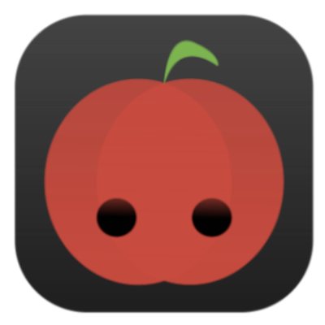

# 🍅 PomoPomo


**PomoPomo** is a minimalist, floating Pomodoro timer widget built with Python and PyQt6. Designed to keep you focused without getting in the way, it features a frameless, translucent design that stays on top of your windows.


## Features

* **Minimalist & Frameless:** A clean, rounded UI with no distracting window borders.
* **Always on Top:** Keeps your remaining focus time visible at a glance.
* **Color-Coded Phases:** Smooth, animated background color transitions let you know what phase you are in:
  * **Focus (25 min):** Red
  * **Short Break (5 min):** Blue
  * **Long Break (20 min):** Green (triggers after 4 focus sessions)
* **Draggable:** Click and drag anywhere on the widget to move it around your screen.
* **Vector Icons:** Crisp, custom-drawn play, pause, and skip buttons with hover animations.

## Preview


*(A screenshot of the PomoPomo widget in action during a Focus phase)*

## Project Structure

```text
PomoPomo/
├── assets/
│   └── icon.png         # The cute apple application icon
├── install.sh           # Bash script for quick installation on Linux
├── main.py              # The main PyQt6 application code
└── README.md            # This file
```

## Installation (Linux) 

PomoPomo comes with a handy installation script that makes it executable and links it to your local bin folder so you can run it from anywhere. ( ^_^)b

### Prerequisites

Make sure you have Python 3 and PyQt6 installed on your system.

```bash
pip install PyQt6
```

### Setup

1. Clone or download this repository.
2. Navigate to the `PomoPomo` root directory in your terminal.
3. Run the installation script:

```bash
./install.sh
```

*Note: If the script doesn't run, you may need to grant it execution permissions first: `chmod +x install.sh`*

## Usage

Once installed, you can launch the timer by simply opening a terminal or your application launcher and typing:

```bash
pomopomo
```

**Controls:**
* **Play/Pause:** Click the play/pause icon to toggle the timer.
* **Skip:** Click the skip icon to immediately jump to the next phase (Focus -> Break -> Focus...).
* **Move:** Click and drag anywhere on the widget's colored background to reposition it on your screen.

## Built With

* [Python 3](https://www.python.org/)
* [PyQt6](https://riverbankcomputing.com/software/pyqt/)

*Stay focused, stay productive! (⁠n__n⁠)*